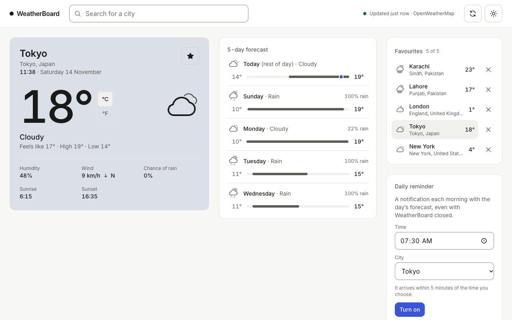
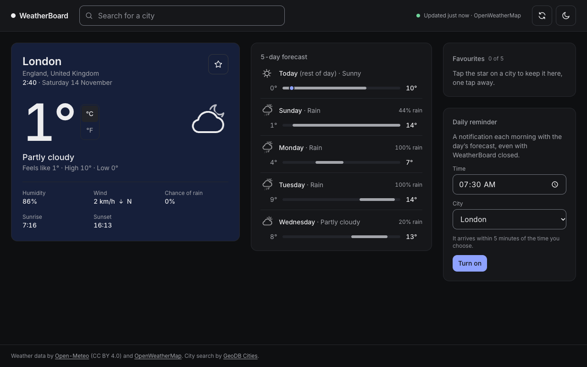
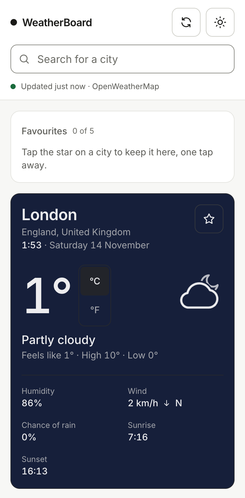
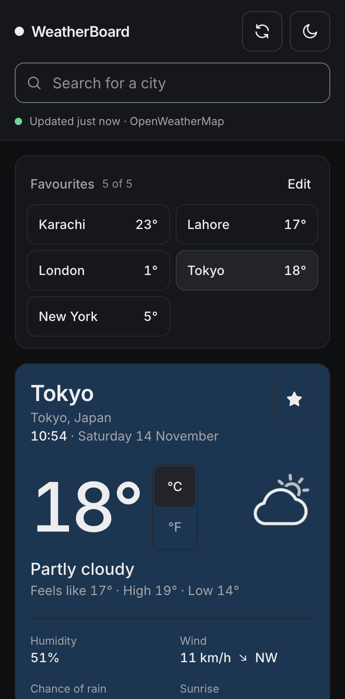
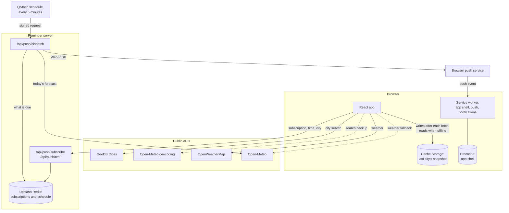
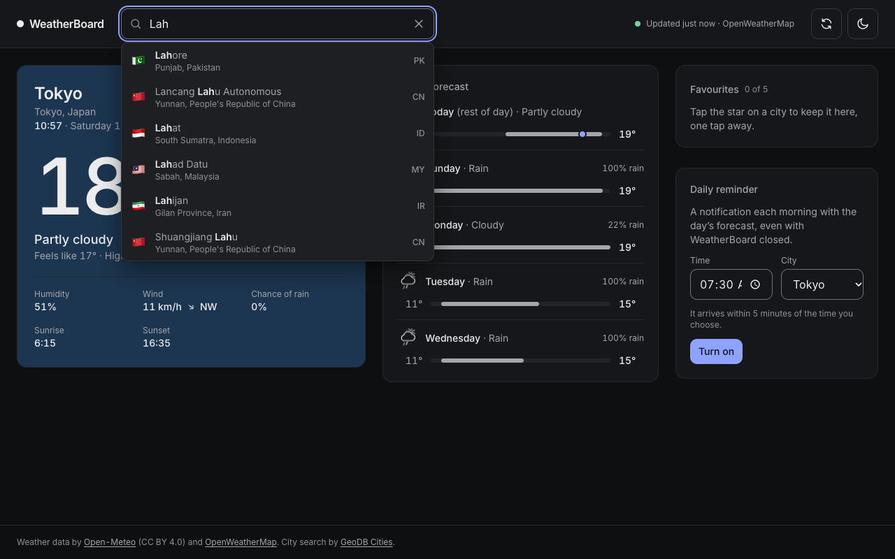
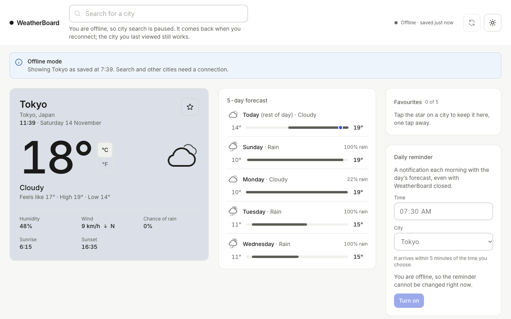
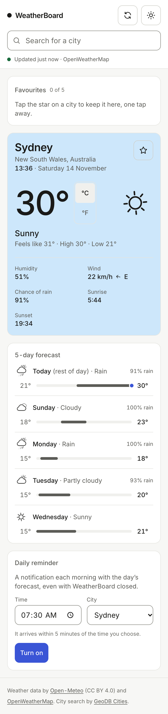
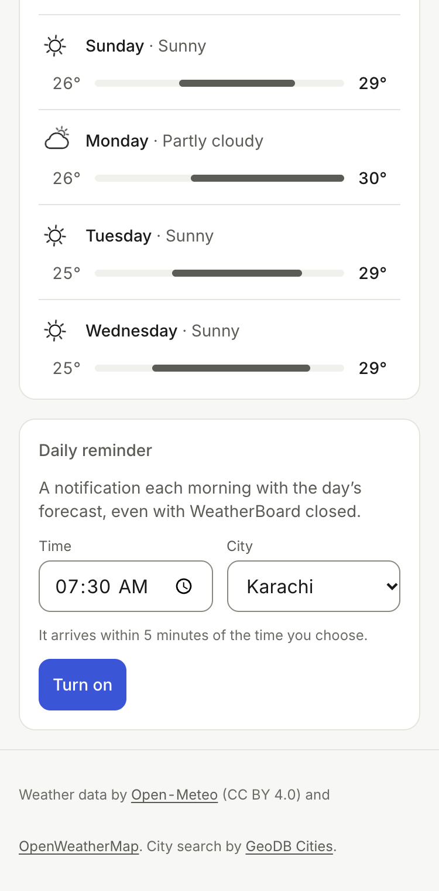
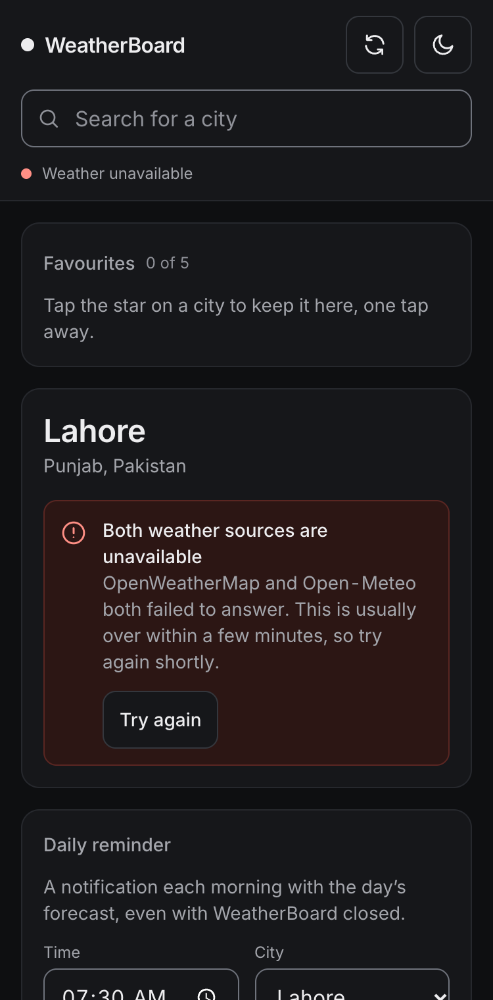

# WeatherBoard

WeatherBoard is a weather dashboard you can install. You search for a city, see the current conditions and a five-day forecast, save up to five favourites, and get a daily reminder with the day's forecast. It keeps working offline for the last city you looked at.

**Live:** https://weatherboard-pi-virid.vercel.app

I built it for the Edspire frontend challenge, using Claude Code inside the Cursor IDE. The prompt history is in [PROMPTS.md](PROMPTS.md) and the plan I worked from is in [docs/PLAN.md](docs/PLAN.md).





<p>
  
  
</p>

All screenshots were taken from the live site with real data. There are more [further down](#more-screenshots).

## Try it in five minutes

Open the [live site](https://weatherboard-pi-virid.vercel.app) in Chrome or Edge on a desktop.

1. **Search.** Type `Lah`. Lahore comes first, with the matched letters marked. Pick it with the arrow keys and Enter.
2. **A nonsense word.** Type `Zzqxv`. The list says no cities match and what to do about it. Clear the field and tab away – the empty-field message appears on blur.
3. **Units.** Press °F beside the temperature. Every number changes at once, with no request. Reload – the choice is kept.
4. **Favourites.** Press the star on the card. Add a few more cities. A sixth is refused with the reason shown beside the star. Remove one – it asks first.
5. **Offline.** In DevTools, open Network and choose Offline. An "Offline mode" banner appears, search pauses with an explanation, and the last city stays on screen with the time it was saved. Reload while offline – the app still opens. Go back online and it refreshes by itself.
6. **Install.** Use the install icon in the address bar, or the install card the app shows after the first city has loaded.
7. **A test reminder.** In the Daily reminder card, press Turn on. The app explains what it will send before the browser asks. Allow it, press "Send a test notification", then close the tab. The notification arrives about ten seconds later with the app closed. The browser itself must still be running.
8. **The backup weather source.** In DevTools, open "Network request blocking", block `api.openweathermap.org`, and press the refresh button in the header. The weather still loads, and the status line now reads "Open-Meteo (backup)".

## Requirement checklist

Paths are relative to `src/` unless they start with `api/` or `e2e/`.

| Requirement                      | Where it lives                                                                                                         | Tests                                                                                                                                 |
| -------------------------------- | ---------------------------------------------------------------------------------------------------------------------- | ------------------------------------------------------------------------------------------------------------------------------------- |
| 01 City search with autocomplete | `features/search/` (combobox, request engine, timing), `api/geodb.ts`, `api/openMeteoGeocoding.ts`, `domain/cities.ts` | `features/search/*.test.*`, `api/citySearch.test.ts`, `domain/cities.test.ts`, `e2e/search.spec.ts`                                   |
| 02 Weather display               | `features/weather/`, `api/weather/`, `domain/forecast.ts`, `domain/conditions.ts`                                      | `api/weather/*.test.ts`, `domain/forecast.test.ts`, `domain/conditions.test.ts`, `features/weather/*.test.tsx`, `e2e/weather.spec.ts` |
| 03 Form validation               | `domain/validation.ts`, `domain/errors.ts`, `domain/errorCopy.ts`, `features/search/CitySearch.tsx`                    | `domain/errorCopy.test.ts`, `features/search/CitySearch.test.tsx`, `e2e/search.spec.ts`                                               |
| 04 Favourite cities              | `features/favourites/`, `lib/safeStorage.ts`, `ui/ConfirmDialog.tsx`                                                   | `features/favourites/*.test.*`, `lib/safeStorage.test.ts`, `e2e/favourites.spec.ts`                                                   |
| 05 PWA and offline               | `sw.ts`, `lib/offlineStore.ts`, `lib/connectivity.ts`, `features/pwa/`, the manifest in `vite.config.ts`               | `lib/offlineStore.test.ts`, `lib/connectivity.test.ts`, `features/pwa/*.test.*`, `e2e/pwa.spec.ts`                                    |
| 06 Push notifications            | `features/reminders/`, `sw.ts`, `sw/notification.ts`, `domain/reminderTime.ts`, `api/push/`, `api/_lib/`               | `features/reminders/*.test.*`, `sw/notification.test.ts`, `domain/reminder.test.ts`, `api/_lib/*.test.ts`, `e2e/reminders.spec.ts`    |
| 07 Responsive design             | `app/AppShell.tsx`, `app/DashboardGrid.tsx`, `styles/tokens.css`                                                       | `e2e/layout.spec.ts` at 375, 768 and 1280: no horizontal scroll, 44 px targets at 375 with touch and with a mouse                     |
| Bonus: dark and light theme      | `features/prefs/theme.ts`, the inline script in `index.html`                                                           | `features/prefs/theme.test.ts`, `features/prefs/ThemeControl.test.tsx`, `styles/tokens.test.ts` (contrast), `e2e/layout.spec.ts`      |
| Bonus: °C and °F                 | `domain/units.ts`, `features/prefs/units.ts`, `features/prefs/UnitToggle.tsx`                                          | `domain/display.test.ts`, `features/prefs/prefsControls.test.tsx`, `e2e/weather.spec.ts`                                              |
| Bonus: animated icons            | `ui/WeatherIcon.tsx`, the keyframes in `styles/tokens.css`                                                             | `ui/WeatherIcon.test.tsx`                                                                                                             |

## Setup

### Prerequisites

- Node 22 (`nvm use` reads `.nvmrc`).
- npm.
- For the reminder functions only: the Vercel CLI, and free Upstash Redis and QStash accounts.

### Environment variables

Copy `.env.example` to `.env.local` and fill it in. Nothing in `.env.local` is committed.

Compiled into the browser bundle, so public:

- `VITE_OPENWEATHER_API_KEY` – a free key from https://home.openweathermap.org/api_keys. A new key can take a while to start working.
- `VITE_RAPIDAPI_KEY` – a RapidAPI key subscribed to the Basic plan of [GeoDB Cities](https://rapidapi.com/wirefreethought/api/geodb-cities). Without the subscription the API answers 403.
- `VITE_VAPID_PUBLIC_KEY` – the public half of a Web Push key pair. Generate the pair with `npx web-push generate-vapid-keys`.

Read only by the functions in `api/`:

- `VAPID_PRIVATE_KEY` – the private half of that pair.
- `VAPID_SUBJECT` – the site's production URL, or a `mailto:` address. Push services use it to identify the sender.
- `UPSTASH_REDIS_REST_URL` and `UPSTASH_REDIS_REST_TOKEN` – from a Redis database at https://console.upstash.com.
- `QSTASH_CURRENT_SIGNING_KEY` and `QSTASH_NEXT_SIGNING_KEY` – from the QStash page of the same console.

Used once from your own machine, never set on the host:

- `QSTASH_URL` and `QSTASH_TOKEN` – used by `scripts/reminder-schedule.mjs` to create the five-minute schedule.

The app runs without the server variables. Turning a reminder on then fails with a message that says so, and everything else works.

### Running the app

```sh
npm install
npm run dev
```

`npm run dev` serves the app only. `npm run build` followed by `npm run preview` serves the production build, including the service worker.

### Running the functions locally

```sh
set -a; source .env.local; set +a
vercel dev
```

This needs a Vercel account and a linked project: run `vercel link` once first. `vercel dev` then serves the app and the three functions under `/api/push` together. It did not pick the server variables up from `.env.local` by itself when I tried it, which is why the first line exports them.

To create or update the schedule that triggers the reminder sender:

```sh
node scripts/reminder-schedule.mjs            # create or update
node scripts/reminder-schedule.mjs --trigger  # also run it once now
node scripts/reminder-schedule.mjs --logs     # recent deliveries
```

### Running the checks

```sh
npm run check      # typecheck, lint, format check, unit tests
npm run test:e2e   # Playwright, against a production build
```

The first end-to-end run needs `npx playwright install chromium`. Tests never read keys from `.env.local` and never call a real API.

## Architecture



Source layout, briefly:

- `src/domain` – pure logic: types, forecast aggregation, city cleaning, validation, units, error copy, reminder times. No React, no `fetch`, no browser globals. A lint rule enforces it.
- `src/api` – the HTTP wrapper and the provider clients. Responses are parsed with Zod at the boundary.
- `src/features` – one folder per feature: search, weather, favourites, pwa, reminders, prefs.
- `src/ui`, `src/app` – primitives and the page shell.
- `src/sw.ts` – the service worker.
- `api/` – the reminder functions.

### Decisions that matter

Each of these is recorded with its number in the Decisions section of [docs/PLAN.md](docs/PLAN.md).

**One weather model, independent of the provider.** Both providers are mapped into the same snapshot type, in SI units. Components never see a provider's field names, and display units are a view concern. This is what makes the fallback invisible to the UI and lets °C and °F switch without a request.

**The fallback is a pure policy with a circuit.** A function of the OpenWeatherMap outcome and the circuit state decides what happens next, so it is tested as a table. A 429 opens the circuit for 10 minutes. Two failures in a row open it. A rejected key opens it for the session, because a bad key does not fix itself. Offline is not a reason to fall back. The header always names the source, so a fallback is visible.

**How a day gets its condition.** The free OpenWeatherMap plan has no daily forecast, only 3-hour readings. I group them by the city's local date. A day is labelled by its most severe meaningful precipitation between 06:00 and 18:00 – meaningful means a chance of 50% or more, or at least 0.5 mm in the reading. Otherwise the reading nearest noon decides. If that reading is itself a too-light shower, cloud cover decides. The label should answer what to plan for. I changed this rule three times during review, each time after looking at a real forecast that read wrong.

**GeoDB limits and result cleaning.** The free plan allows 1 request per second and 1,000 a day. So the search caches by prefix for the session, filters a complete earlier result locally instead of asking again, and spaces network requests one second apart. The first request goes at the second letter; after that it waits 150 ms after typing stops. The raw results also needed work: with a city-type filter Lahore is missing, because GeoDB files it as two administrative areas, and "Greater London" ranks above London. I ask for the ten largest matches with no filter and clean them in `domain/cities.ts`: plain names, one entry per place, a city ahead of a district. Names that start with what you typed come before names that only match on a later word, so "Par" leads with Paris and not with two larger districts called Parganas. Two results count as one place only if their names are related as well as close – distance alone would merge real neighbours.

**Typed errors, and a test on the copy.** Every failure becomes an `AppError` with a kind (offline, network, timeout, rate-limited, auth, not-found, provider-down, bad-response) and a source (the weather providers, city search, the reminder server, the browser's own push service). `errorCopy()` returns a title, a message and an action for all 48 combinations. A test walks every combination and rejects vague phrases and messages that give the user nothing to do. It rejected five of my first messages.

**Safe storage.** Everything that touches `localStorage` goes through one wrapper. If storage is blocked or full, the app keeps working from memory and says so. Stored data is never trusted: favourites are versioned and cleaned on every read.

**The app owns the offline snapshot, not the service worker.** The service worker caches the app shell and nothing else. The last city's weather is one normalized snapshot the app writes to Cache Storage after each successful fetch. Caching raw provider responses in the worker would key entries by URLs that contain the API key, and could serve an older OpenWeatherMap response over a newer Open-Meteo one. This way there is one source of truth. Offline is treated as a mode, not an error.

**The reminder server is the one exception to client-only.** A reminder that arrives with the tab closed cannot come from the browser alone. A closed tab is only woken by a push message, and a push message needs a server that holds the keys and fires at the chosen time. Service worker timers die within seconds, and the browser APIs that might have done it are either abandoned or Chromium-only with no control over the time. So I added the smallest server I could:

- Three functions: subscribe (and unsubscribe), a test send, and a dispatch. Weather and search never go through it.
- The schedule is data: a Redis sorted set of subscriptions scored by their next fire time. One QStash schedule calls dispatch every 5 minutes, and "what is due" is one range query. A pure function computes the next occurrence from the time zone's own rules, so daylight saving needs no special case.
- A due reminder is claimed before it is sent, so overlapping runs cannot send twice.
- Protection: dispatch only accepts requests signed by QStash. The other two are same-origin only, validated with Zod, capped at 4 KB, rate limited to 30 a minute per address, and limited to 500 stored subscriptions. Push addresses are accepted only from known push services, because the server later posts to whatever address it stores. Subscriptions the push service reports as gone are deleted.

## The 300 ms requirement

I measured the time from the last keystroke to the city being on screen, in Chromium against the live GeoDB API from Karachi. Each figure is two runs, typing the full name at 80 ms a key (fast) and 250 ms a key (slow). "Before" is the first version I submitted; "after" is the current one.

What changed: the first request now goes out at the second letter and is never cancelled. Its page holds the ten largest places for those two letters. While you type on, the matches from that page are shown at once, and the request for the full text adds the rest underneath.

Large cities – in GeoDB's ten largest for their first two letters:

- Lahore, fast: 752–888 ms before, 181–343 ms after. Slow: 600–610 ms before, already on screen when typing stops after.
- London, fast: 813–836 ms before, 204–205 ms after. Slow: 650–694 ms before, already on screen after.
- Karachi, fast: 806–929 ms before, 96–104 ms after. Slow: 1,383–1,612 ms before, already on screen after.
- Skardu, fast: 738–761 ms before, 164–183 ms after. Slow: 590–740 ms before, already on screen after.

A small town – Murree, not in the ten largest for "Mu":

- Fast: 856–1,473 ms before, 1,274–1,331 ms after.
- Slow: 701–737 ms before, 1,443–1,509 ms after.

What this means, plainly:

- **Met** for a city that is among the ten largest for its first two letters, once you have typed for about a third of a second past the second letter. I checked 12 cities with real requests (Lahore, Karachi, Islamabad, Rawalpindi, Faisalabad, Multan, Peshawar, Quetta, London, Paris, New York, Dubai): 11 are in their two-letter page. Paris is the one that is not.
- **Met** for anything already seen in the session, and whenever a recent city or favourite matches (4–32 ms).
- **Close, not guaranteed** for a fast typist on a large city: one of my eight fast runs took 343 ms.
- **Not met, and now slower,** for a place outside its two-letter page. GeoDB allows one request a second, so the request for the full text has to wait a full second after the early one. That costs a small-town search roughly half a second to three quarters of a second more than before. I accepted this trade: most searches are for large cities.
- **Not met** for a two- or three-letter query typed quickly and left there. The first answer still takes as long as GeoDB takes, about 600–800 ms.

The cost in quota: a new search now uses 2 requests where a fast typist used 1 (the early one and the full text), and 3 for a slow typist on a longer name. Picking a city from the early matches within the first second uses 1. A repeated search uses none.

The preview deployment is behind Vercel's sign-in, so these runs timed the list in the page (last keydown to the city's row appearing) rather than reading the dev-only `wb:suggestions` mark, which does not ship in a production build. To see the mark: `npm run dev`, type in the search field, then run `performance.getEntriesByName('wb:suggestions')` in the console.

## APIs used

- **OpenWeatherMap** – current weather and the 5-day / 3-hour forecast. Free plan: 60 calls a minute, 1,000,000 a month. Needs a key.
- **Open-Meteo** – the fallback weather source, the backup geocoder for search, and the forecast inside reminders. No key. Free for non-commercial use: 600 calls a minute, 5,000 an hour, 10,000 a day, 300,000 a month.
- **GeoDB Cities via RapidAPI** – city autocomplete. Basic plan: 1,000 requests a day, 1 a second, 10 results per call. The per-second limit is not published in a header; I observed it by sending three requests at once.
- **Web Push and the Notifications API** – the daily reminder, through the service worker.
- **Upstash Redis and QStash** – storage and the trigger for the reminder server. Free tiers: 500,000 Redis commands a month, 1,000 QStash messages a day. The schedule uses 288 a day.

Attribution: weather data by [Open-Meteo](https://open-meteo.com/), licensed under [CC BY 4.0](https://creativecommons.org/licenses/by/4.0/). The same credit is in the app's footer, with OpenWeatherMap and GeoDB Cities.

## Known limitations

- **The API keys are visible in the bundle.** The weather and RapidAPI keys ship to the browser, because those calls are client-side. Neither provider supports restricting a key to a site. They are free-tier keys and I will rotate them after the review. A small proxy would fix it.
- **GeoDB is slow and tightly limited.** A large city now appears within about a third of a second of the last key, but a small town takes over a second – see the 300 ms section. The 1,000-a-day quota is shared by everyone using the live site. When it runs out, search falls back to Open-Meteo's geocoder, whose matching is looser.
- **Reminder timing.** A reminder arrives within 5 minutes after the chosen time, not on the minute. One that would be more than an hour late is skipped. On a desktop the browser must be running, though no tab needs to be open.
- **iOS only when installed.** Web Push on iPhone and iPad works only for an app added to the Home Screen (iOS 16.4 or later). In a Safari tab the reminder card shows the steps to add it.
- **Day labels differ on the backup source.** Open-Meteo's daily code is the most severe condition of the day with no threshold, so a day with a trace shower is labelled rain where my own rule would say cloudy. I left it. The header says when the backup served the data.
- **Latin-only fonts offline.** Only the Latin font files are cached with the app shell. Other scripts fall back to the system font.
- **One city offline.** Only the last viewed city is kept. Another city opened offline gets an explanation, not weather.
- **A replaced push subscription is handled but untested.** The service worker re-registers when the browser rotates a subscription (`pushsubscriptionchange`). I have no test for it and have not seen it fire.

### What was verified, and how

Verified automatically, on every push:

- 889 unit and component tests, against recorded real API responses.
- Playwright tests in Chromium at 375 px (touch and mouse), 768 px and 1280 px: layout, touch targets, search, weather, favourites, offline flows, installability through the DevTools protocol, and the reminder card's flows with the server answered by the test.

Verified by me against the live site, in desktop Chromium:

- Search, weather, favourites and the offline flows.
- That the reminder endpoints refuse unsigned, cross-origin and malformed requests.
- That the QStash schedule exists and that a manual and a scheduled run reached the dispatch function and returned 200.

Verified by me on real devices – a MacBook in Chrome, and an iPhone with the app installed from Safari:

- A test notification arrived with the tab closed.
- Tapping it opened the app on the right city.
- A scheduled reminder arrived within 5 minutes of its time.
- The installed app reopened offline on the last city, with the "Offline mode" banner.

Not verified on a real device:

- Android phones, tablets, and any other desktop browser.
- Safari and Firefox. The core flows passed once in Playwright's WebKit build, which is not Safari. Firefox could not be run: Playwright's Firefox build does not start on my machine ("Could not find profile folder"), in two separate attempts.
- The update prompt between two real deployed versions.
- A replaced push subscription (`pushsubscriptionchange`).
- Anything else not listed above. The phone-sized automated tests ran in desktop Chromium, not on a phone.

## Testing and CI

- Unit and component tests use Vitest, Testing Library and MSW. Fixtures in `tests/fixtures` are recorded responses from the real APIs – I never wrote a response by hand. A request no test expected fails the test.
- End-to-end tests use Playwright against a production build with placeholder keys, and answer API calls from the same recordings.
- A few tests guard things that are easy to break quietly: colour contrast for every text and background pair in both themes, the error copy, the fallback table, and layout shift when data arrives.
- GitHub Actions runs typecheck, lint, format check, unit tests and a build in one job, and the Playwright suite in another. Pushing to `main` deploys to Vercel.

## What I would do next

- Put the weather and search calls behind a small proxy, so no key reaches the browser and the GeoDB quota can be cached across users.
- Run the end-to-end suite in WebKit and Firefox, and on real devices.
- Aggregate Open-Meteo's hourly data with my own day rule, so both sources label a day the same way.
- Keep offline snapshots for the favourites, not only the last city.
- Test the subscription-rotation path, and add an end-to-end reminder test against a real push service.
- Offer more than one reminder, and languages other than English.

## How it was built

I worked with Claude Code inside the Cursor IDE. I started with a plan and reviewed it before any code was written, set standing rules in [CLAUDE.md](CLAUDE.md), and then worked on one slice per prompt. Each prompt opened with my decisions on the previous output.

- [PROMPTS.md](PROMPTS.md) – every prompt, in order and verbatim, with what came out of it and where I changed the agent's output.
- [docs/PLAN.md](docs/PLAN.md) – the plan, the risks, and every decision with its reason.
- [docs/AUDIT.md](docs/AUDIT.md) – an independent review I ran before submitting, and what I did about each finding.

## More screenshots

Each is available at 375 and 1280 px in both themes, in [docs/screenshots](docs/screenshots).

Search suggestions:



Offline mode:



A daytime card, the reminder card and an error state at 375 px:

<p>
  
  
  
</p>

The error state was produced by answering both weather sources with a 503 in the browser. Everything else is the live app with real data.
